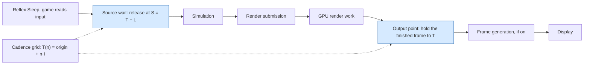
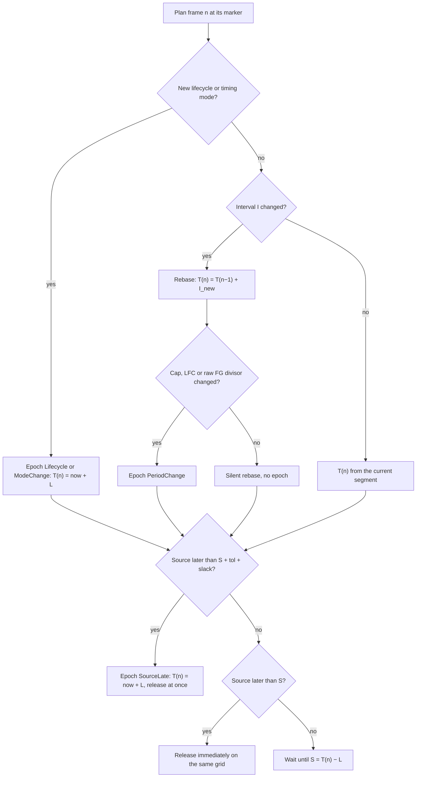
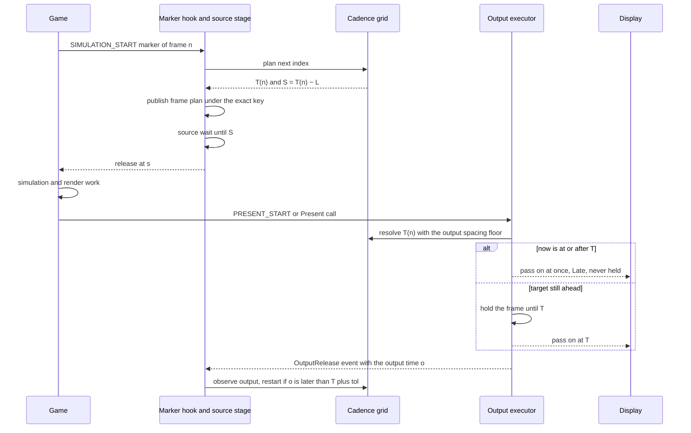
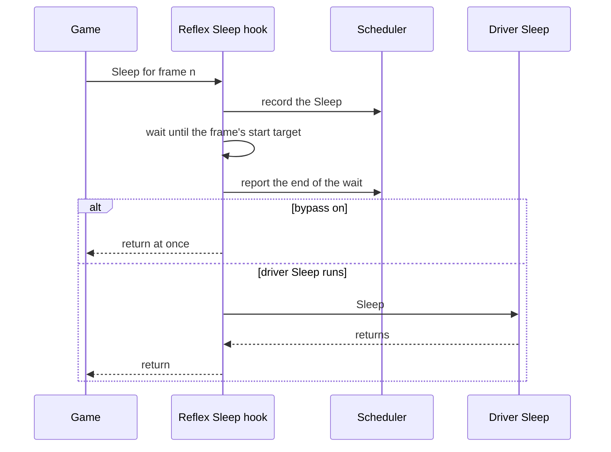
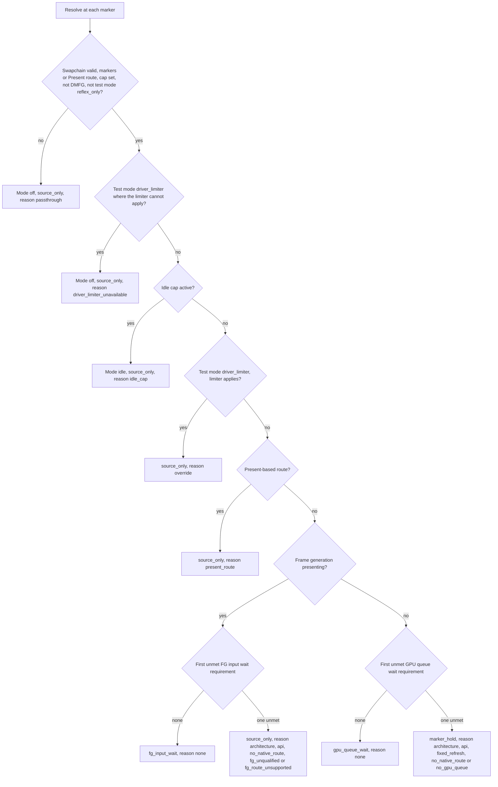
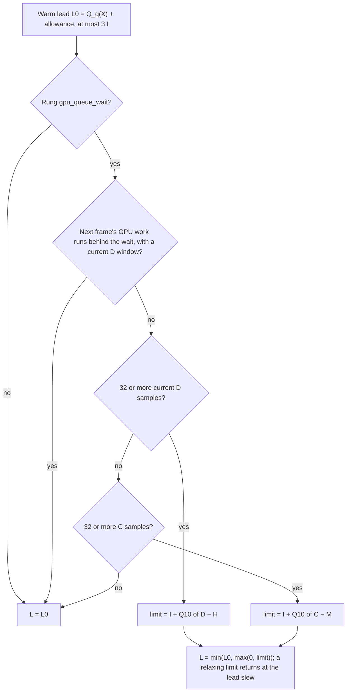
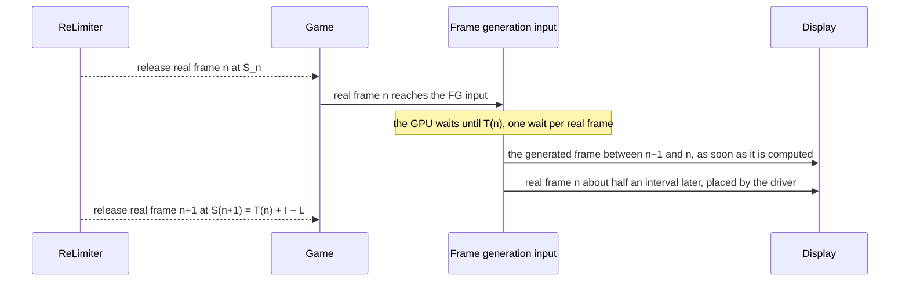
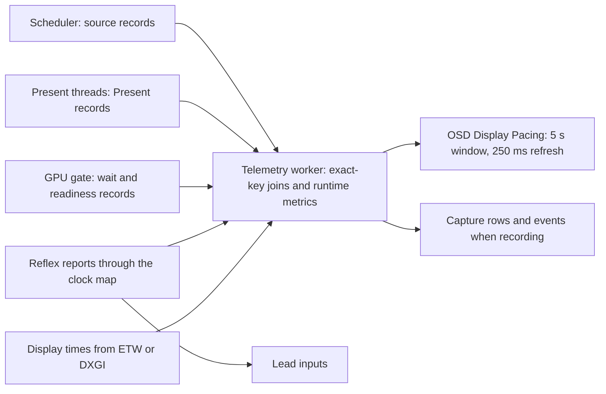

```mermaid
gantt
    title Targets and releases, I 16 ms and L 6 ms, illustrative numbers
    dateFormat x
    axisFormat %L
    section Frame 1
    Game work              :a1, 1010, 3ms
    Hold to target         :a2, 1013, 3ms
    Target T1              :milestone, m1, 1016, 0ms
    section Frame 2
    Game work              :b1, 1026, 3ms
    Hold to target         :b2, 1029, 3ms
    Target T2              :milestone, m2, 1032, 0ms
    section Frame 3 late
    Game late for its marker :crit, c0, 1042, 8ms
    Game work              :c1, 1050, 3ms
    Hold to restarted target :c2, 1053, 3ms
    Target T3 after restart :milestone, m3, 1056, 0ms
    section Frame 4
    Game work              :d1, 1066, 3ms
    Hold to target         :d2, 1069, 3ms
    Target T4 is T3 plus I :milestone, m4, 1072, 0ms
```

# How ReLimiter Paces Frames

This document explains how ReLimiter's frame pacing works, with diagrams. It is written for technically interested users, testers and new contributors. It describes current behavior only; the [User Guide](USER_GUIDE.md) covers what a player needs to know and the [Developer Reference](DEVELOPER_REFERENCE.md) covers developer settings, Details lines and log lines.

Nobody is expected to tune any of this. ReLimiter has no pacing settings besides the frame-rate caps and the Pacing preference: smoothing is always on, the output point is always chosen automatically, the Reflex Sleep is replaced by ReLimiter's own wait while it paces a cap, and the source wait runs inside the Reflex Sleep call. Every number below is a built-in value, not a setting.

Each section ends with the source files it describes. Diagrams that use numbers say so; those numbers only illustrate the shape of the timing.

---

## Table of Contents

1. [Overview](#overview)
2. [The Cadence Grid](#the-cadence-grid)
3. [Frame Plans and the Lead](#frame-plans-and-the-lead)
4. [Where the Source Wait Happens](#where-the-source-wait-happens)
5. [Output Points](#output-points)
6. [Protecting Pacing Under Load](#protecting-pacing-under-load)
7. [Frame Generation and Dynamic MFG](#frame-generation-and-dynamic-mfg)
8. [Measurement and Feedback](#measurement-and-feedback)
9. [Glossary](#glossary)

---

## Overview

A game does not finish its frames at an even rate. Each frame passes through simulation, render submission, a Present call and GPU work, and how long that takes changes from frame to frame. Queues between the stages (in the game's own threads, in the driver and on the GPU) hide some of that, but a queue that fills adds latency and one that drains lets the next frame arrive in a hurry. A limiter that only delays the game at one point fixes the average frame rate, not the spacing of the frames that reach the display.

ReLimiter uses two stages that share one clock, the cadence grid:

1. **Release the game on a cadence (the source wait).** Every frame has an output target `T`. ReLimiter releases the game at `S = T − L`, where the *lead* `L` is how long recent frames needed from release to being finished, with a little extra. Most frames are then finished a little before `T`.
2. **Hold the finished frame to its target (the output point).** A frame that is ready early waits until `T` before it passes on, so the display sees frames at an even spacing. A frame that is not ready by `T` is never held.

The small wait at the output point is the latency cost of an even cadence. The grid supplies the targets for both stages, so release and output always agree on the same row of times.



The two highlighted steps are where ReLimiter acts. Where exactly the output point sits depends on the output: a CPU hold at the game's Present marker, a GPU wait on the present queue or a GPU wait in front of the frame-generation input (see [Output Points](#output-points)). The source wait happens either in the game's frame-start marker call or earlier, inside the Reflex Sleep call (see [Where the Source Wait Happens](#where-the-source-wait-happens)).

Three rules hold everywhere:

- **Late frames are never held.** A frame that misses its target passes on at once; the cadence is restarted when it is clearly late.
- **No catch-up burst.** After a late frame the next targets are not squeezed together to make up the time.
- **No mode switching on thresholds.** ReLimiter picks the best output point the game supports and keeps it.

The pieces that decide the details:

| Piece | Role | Section |
|-------|------|---------|
| Cadence grid | The row of targets `T(n)`, restarted in epochs | [The Cadence Grid](#the-cadence-grid) |
| Lead controller | Learns `L` from measured frames | [Frame Plans and the Lead](#frame-plans-and-the-lead) |
| Source stage | Plans each frame, waits until `S`, releases the game | [Frame Plans and the Lead](#frame-plans-and-the-lead) |
| Pipeline resolver | Chooses the output point and where the source waits | [Output Points](#output-points) |
| Output executors | Hold or pass on each finished frame | [Output Points](#output-points) |
| Protections | Collision-aware release | [Protecting Pacing Under Load](#protecting-pacing-under-load) |

Source: `src/scheduler.cpp` (`OnMarker`, `RunPlanned`), `src/source_stage.h`, `src/cadence_grid.h`, `src/pacing_resolver.h`.

---

## The Cadence Grid

There is one grid per swapchain, owned by the scheduler. Every real frame gets the next grid index `n` and an output target `T(n)`. Every stage takes its target from the grid: the source stage plans from it and the output executors re-resolve `T(n)` from the grid's newest published snapshot, so a restart moves targets of frames that have not been output yet.

The grid is a row of linear segments:

```
T(n) = origin + floor(fraction + (n − base) · I + 0.5)
```

A new segment starts whenever the interval changes or the cadence restarts. The snapshot keeps the newest 8 segments so frames a few plans behind (for example during a frame-generation multiplier ramp) still resolve their target.

### The interval I

`I` is the interval between real frames:

| Contribution | Effect on `I` |
|--------------|---------------|
| FPS cap | `1 / cap`. This is the interval before anything else. |
| Frame generation | Multiplied by the FG divisor (2× FG: `I` is two output intervals, because the cap is the *output* frame rate and the grid paces *real* frames). |
| LFC | While the display gets fewer frames per second than its VRR range, `I` is rounded up so that each displayed frame lasts a whole number of VRR ceiling intervals: a whole multiple of `D` ceiling intervals, `D` the FG divisor. It is judged on the displayed interval `I / D`, so frame generation's real-frame rate below the range does not count. LFC turns on after 10 consecutive frames below the range and off after 10 consecutive frames at or above it. |
| Fixed refresh | On a fixed-refresh display the grid snaps `I` to `k` whole refreshes when it is within 2% of that, and snaps targets to vblank edges. |
| Idle caps | Background FPS, FG-Off Cap and OLED Care run the grid in *idle* mode: lead 0 and no output hold. |

### Epochs

An *epoch* is a stretch of the grid with one phase. A restart starts a new epoch and the new target row begins from a fresh origin. The reasons:

| Reason | What starts it | New origin |
|--------|----------------|------------|
| `Lifecycle` | First plan of a lifecycle: graphics API change, full swapchain teardown, producer change or route change | `T(n) = now + L` |
| `ModeChange` | Timing mode changed between off, VRR, fixed and idle (for example focus lost or regained) | `T(n) = now + L` |
| `PeriodChange` | Cap, VRR ceiling, LFC multiple, raw FG divisor or idle cap changed `I` | Continues from the previous target: `T(n) = T(n−1) + I_new` |
| `SourceLate` | The game reached its source wait later than `S` plus the late tolerance plus its slack | `T(n) = now + L`, released at once |
| `OutputLate` | A frame's output came later than `T(n)` plus the late tolerance | `T(n+1) = o + I`, `o` being that output time |

Interval changes that are not one of these (the 50 ms FG divisor ramp) are *silent rebases*: the grid continues from `T(n−1) + I_new` and no epoch is counted.

The **Grid epoch** counter in Details counts epochs. An occasional increase is normal.

### Late tolerance and slack

The late tolerance is `tol = max(I / 4, 500 µs)`.

- **Output late.** A finished frame whose output time `o` is later than `T(n) + tol` starts an `OutputLate` epoch. Output evidence that arrives for a frame older than the epoch's base is converted to the equivalent output of the base frame first (`o + (b − n) · I`), so a pipelined game whose next source was already planned does not get a short display interval.
- **Source late.** A source that arrives after `S` is released at once on the same grid when it is within `tol` plus its *slack*. The slack is `L` minus the median measured `X` of the rung (never more than `L`); a source that still makes `T` does not restart the cadence. Later than that, the grid restarts (`SourceLate`). The `S` it is judged against uses the shorter of this frame's lead and the previous frame's: the game's wait before the marker aimed at the previous frame's lead, and ReLimiter switches the lead at once when the output changes (another output's lead, a restarted lead). Judged against the new lead, the first frame after the FG input wait took over restarted the cadence and moved the targets 4.4–10.5 ms later (CONTROL Resonant, FG 2× at 130, lead 17.15 → 21.65 ms).
- **Idle mode** ignores output evidence: its lead is 0 and nothing is held, so late evidence would only stretch the cap.

### No catch-up burst

An output executor holds frame `n` until `max(T(n), o(n−1) + I − slack)` with `slack = tol / 2` and `o(n−1)` the recorded output time of the previous frame (no floor when it is not known). A frame that came out late therefore spaces the next one a full interval after it, minus half a tolerance. Lateness beyond that half tolerance shrinks by half a tolerance per frame instead of pushing the whole cadence later or releasing a burst of short frames.

On the GPU waits the recorded output is the target or the time the frame was decided late, taken on the CPU when the wait is queued. A real frame that reaches the FG input wait after its Signal passes when its GPU work finishes, later than that record, so the floor alone does not see it. DLSS Frame Generation shows a generated frame a fixed time after the previous real frame and the real frame when it is ready, so a real frame's timing error lands mostly on one displayed interval. **FG late-frame spacing** therefore raises such a frame's record to its GPU readiness when it is read back, resolves the next real frame's floor again just before its Signal, and takes the floor's slack from the displayed interval `T_out = I / D` (`slack = max(T_out / 4, 500 µs) / 2`, `D` the frame's FG divisor). A real frame then enters frame generation no sooner than `I − slack` after the previous one, so each displayed interval is shortened by at most about that slack, as without frame generation. The target only moves later, within the GPU wait horizon; a move beyond `tol` restarts the cadence like any late output.

A floor move is never made while the game's render thread is still inside the frame's Present when the frame's original target arrives (no PRESENT_END marker of that frame yet). In Streamline's cycle that hold would also hold the render thread, and the next frame would wait behind it: in CONTROL Resonant at 157 FPS with 2×, where the GPU is the limit, the next frame came out late after 42% of such holds against 3% of the others. The worker wakes at the original target to check, releases such a frame there and records that release; at 60 FPS with 2× the render thread had always left by then. Without PRESENT_END markers no move is made.

### Illustration

The chart below uses invented round numbers (`I = 16 ms`, `L = 6 ms`, times in ms on an arbitrary axis) to show the shape of a restart. Frames 1 and 2 are released at `S = T − L`, finish early and wait to their target. The game reaches the marker of frame 3 more than a tolerance and its slack after `S`, so the cadence restarts: the target becomes `now + L`, the frame is released at once and held to the new target. Frame 4 follows one interval later; no frame is shortened to catch up.



How the grid plans one frame:



Source: `src/cadence_grid.h`, `src/cadence_grid.cpp` (`PlanNext`, `CadenceGrid_LateToleranceTicks`, `CadenceGrid_ResolveOutputTarget`), `src/pacing_core_types.h` (`PacingEpochReason`), `src/scheduler.cpp` (`VrrCapIntervalUs`, `ApplyLfc`), `src/period_governor.cpp` (`PeriodGovernor_LfcIntervalUs`, `LfcHysteresis`), `src/fg_divisor.cpp` (50 ms ramp), `src/source_stage.cpp` (slack).

---

## Frame Plans and the Lead

### The frame plan

When the game reaches its enforcement marker, the source stage asks the grid for the next index, which gives the frame's target `T`, and computes the source wake time:

```
S = T − L
```

It then publishes a *frame plan* (index, epoch, target, wake time, lead, interval, FG divisor, output point) under the frame's exact key, before it starts waiting. The output executors later look the plan up by that same key and claim it exactly once; a plan that belongs to another output point is never substituted. A source wait is clamped to two grid intervals so a bad target cannot hang the game.

### How the lead is learned

The lead controller keeps one bucket of measured samples per output point and FG divisor. A sample `X` is how long a frame took from its source release `s` to the output point's reference time, without ReLimiter's own holds. What `X` measures depends on the output:

| Output | `X` is measured to | Own holds excluded how |
|--------|--------------------|------------------------|
| `source_only` | PRESENT_START marker arrival `a`: `X = a − s` | Nothing is held |
| `marker_hold`, `native_hold` | PRESENT_START (or the native Present arrival): `X = (a − s)` minus the overlap with the previous frame's CPU hold | The overlap is removed |
| `gpu_queue_wait` | The frame's GPU readiness `r`, floored at the Present call `p`: `max(p, r) − s`. When the next frame's GPU work runs behind the wait (below): `max(p, r − d) − s` | `d = max(0, f − w_c)` is how long the frame's submitted GPU work waited for the GPU to pass the previous frame's gate: `f` is when it did (that frame's readiness, or its resume when its GPU waited at the Signal), `w_c` when this frame's first GPU work reached the driver (RENDERSUBMIT_START plus the median first-submission delay, at most `p`; `p` without the marker). A frame the cap released whose own submissions set its readiness keeps `d` (below) |
| `fg_input_wait` | The same readiness measure, with its own queue order. The lead sample is `X − q` | `d` as above. `q` is the time the finished frame waited for the game's render thread to leave the previous frame's Present (SIMULATION_END to the previous PRESENT_END, at most until RENDERSUBMIT_START) |

**Queue order of the GPU waits.** Each GPU wait pairs a release whose GPU waited at it with the next frame's GPU start (from the Reflex report): when the next frame had begun submitting before the release but its GPU work started only after it, that work runs behind the wait. After 32 such pairs with none concurrent, and while Reflex reports keep arriving, the wait's verdict is *behind the wait*; one pair whose next frame's GPU work started more than 0.1 ms before the release ends it at once. Behind the wait, a frame's readiness follows ReLimiter's own release of the previous frame (`r_n = o_{n−1} + P_n`), so the measured `X` is `L + P_n − I` and moves with the lead itself: in CONTROL Resonant with FG 2× at 130 FPS the lead rose from 20 to 39–43 ms after one heavier second and stayed there after the load fell, at about 20 ms more PC latency. Leaving out `d` gives each frame's own work, which the lead can fall back to. The previous frame's frame generation after its gate stays in `X`. A frame whose own late submissions set its readiness keeps `X`, because its readiness then follows its own release, not the previous frame's: the frame's Reflex report shows its GPU waited 1 ms or more inside its work for its submissions while its first work reached the driver early in its render submission, and the cap released it. In Gears of War: E-Day with FG 2× at 120 FPS, such frames were ready 28–31 ms after their release; leaving out `d` there settled the lead at 29 ms with half of them ready after their targets. Starvation alone is not enough: with a long lead Gears' first work reached the driver only when the previous frame's Signal came, the GPU then caught up with the held submissions, and keeping `X` for those frames held the lead at 45 ms. Their sample therefore waits for the frame's report (about two intervals); a frame that closes without one leaves `d` out. Where the GPU starts the next frame's work beside the wait (Deep Rock Galactic: Rogue Core, most pairs concurrent), or while the order is unknown, `X` is the measured readiness. A frame's slack, its lateness evidence, always takes the measured readiness at once: a frame the GPU cannot finish by its target is late.

The lead for the next frame comes from the bucket's samples:

- **Window.** The newest 256 samples. A sample longer than 3 `I` is left out of the lead (it still counts as a missed target).
- **Warm and warming.** With fewer than 32 samples the bucket is *warming* and the lead is a starting estimate: `I / 2` limited to 1–8 ms. From 32 samples it moves by one lead slew step per frame toward the warm target. A reset by the cap, the FG multiplier, a new lifecycle or a route change carries no lead and starts from its own estimate. From 32 samples the bucket is *warm*.
- **Quantile plus allowance.** The warm target is the 99th percentile of the window plus an allowance of 0.5 ms. About 99 of 100 frames are then finished before their target, and the rest are late and never held.
- **Spike floor.** While a GPU wait's queue order is *behind the wait* (below), the warm target is at least `Q_tail(a) + Γ`. `a` is how long after its release a frame's first GPU work reached the driver, without the time its finished simulation waited for the render thread: `(w − s − q) + F_n`, `F_n` the frame's own RENDERSUBMIT_START → first driver submission, from frames whose first work streamed and whose render thread did not take them only at the previous frame's Signal. `Q_tail` is the second-largest of the maxima of the newest 32 blocks of 64 arrivals, so every arrival of about the last 31 seconds but the longest is covered, and `Γ` the median GPU start → readiness time of the newest 32 frames. The lead's own percentile leaves a game's rare long simulations out, and while the GPU runs back to back a frame whose work arrives that late leaves the GPU idle; every later frame inherits the lost time. The floor gives those frames room at the cost of latency in such scenes. Where the arrival tail is short (lighter scenes, or games whose render thread starts before the simulation ends) it lies below the lead and changes nothing, and it never counts toward the budget below.
- **Slew.** After the first warm lead, the lead moves toward its target by at most `min(100 µs, I / 64)` per planned frame.
- **Budget.** The lead is limited to `[0, 3 I]`. Details marks `, at budget` when the wanted lead was longer, so those frames are likely to miss their targets.
- **Output-specific limits.** On `gpu_queue_wait` the collision-aware release can lower the lead further (see [Protecting Pacing Under Load](#protecting-pacing-under-load)). Nothing else limits the GPU wait's lead.
- **Other placements.** Present-based pacing uses a fixed 150 µs lead; idle mode and passthrough use 0.

**Games that wait for the next release.** Some engines finish frame `n`'s Present only after ReLimiter has released frame `n + 1`. ReLimiter's waits for later frames are not that game's time, so the late-output check, and the slack evidence judge such a frame without them. The lead keeps the measured `X`, because such a frame cannot be ready before the release it waits for. In a pipelined engine the next frame's wait overlaps the previous frame's render submission, so on the GPU waits this credit also covers lateness from the GPU's own throughput: in Gears of War: E-Day with FG 2× at 120 FPS it was 11–12.5 ms on most frames, and of the 12–28% of frames ready after their targets 0.2–1.4% counted, with the GPU running back to back. Counting those frames (crediting only the GPU's idle inside the frame) changed no display measure in Gears or CONTROL Resonant beyond the run-to-run spread and only lengthened the interval about 3%, so the full credit stays.

### One planned frame



Source: `src/source_stage.h`, `src/source_stage.cpp` (`RunPlannedFrame`, `DrainStageEvents`), `src/frame_plan.h`, `src/lead_controller.h`, `src/lead_controller.cpp` (`NextLeadUs`, `SampleUs`, `QueueUs`, `EmitSample`), `src/pacing_resolver.cpp` (lead parameters), `src/pacing_core_types.h` (`PacingFramePlan`).

---

## Where the Source Wait Happens

The source wait can sit in two places on marker routes (games with NVIDIA Reflex markers or Streamline PCL markers): inside the Reflex Sleep call or in the marker call. Present-based pacing, which has no markers, waits at the Present call.

**Marker placement.** The wait runs inside the game's call for the *enforcement marker*, normally SIMULATION_START. The game's thread is blocked in that call until `S`. If a game never sends SIMULATION_START (no admitted one after 200 direct markers while RENDERSUBMIT_START is seen), the enforcement marker falls back to RENDERSUBMIT_START, and returns to SIMULATION_START after 8 consecutive direct SIMULATION_START markers.

**Reflex Sleep wait.** When the game has called the Reflex Sleep within the last second, ReLimiter does the source wait inside that Sleep call, before the game reads input for the next frame; the Details line reads `Placement: unified`. The unified pacer's start law sets when the Sleep returns: the previous release plus the interval, never earlier than the display, the game's own Sleep-mode interval and the GPU's frame time allow, with a bound on the frames the GPU has not finished (see the Developer Reference, *Unified pacer*). Idle caps use the same wait. A game that does not call the Reflex Sleep, and NVIDIA Smooth Motion, wait in the marker call instead.

### Reflex Sleep bypass

ReLimiter's own wait replaces the driver's Sleep. After ReLimiter's wait the Sleep hook returns without calling the driver; Reflex markers and the game's Reflex mode still reach the driver. The reason is a single pacer: the driver's Sleep otherwise adds a wait of its own after ReLimiter's, and the two would then pace the game independently.

The driver's Sleep still runs when ReLimiter is not pacing the source: with no FPS cap, in Dynamic MFG passthrough, without a presenting swapchain, or in the developer test modes (`pacing_test_mode`, see the Developer Reference), where the game's own Sleep runs and ReLimiter either plans nothing or leaves the pacing to the Reflex driver limiter. NVIDIA Smooth Motion skips the Reflex Sleep entirely.

While the driver's Sleep runs (ReLimiter is not pacing, or a developer test mode) the Sleep hook also times it for the presenting device (`driver_sleep_start_qpc` and `driver_sleep_end_qpc` of the pacing rows).



Source: `src/unified_pacer.h`, `src/unified_pacer.cpp`, `src/scheduler.cpp` (`DriverSleepRuns`), `src/nvapi_hooks.cpp` (`Hook_Sleep`, enforcement marker fallback), `src/nvapi_hooks.h` (`NvAPI_ShouldBypassSleep`), `src/pacing_resolver.cpp` (`MarkerRoutePlacement`).

---

## Output Points

An *output point* (the *rung* in the code) is where the finished frame is held to its target. ReLimiter has four:

| Output | What it holds | Requirements | Notes |
|--------|---------------|--------------|-------|
| `gpu_queue_wait` | The GPU's present queue waits for `T` before it runs the frame's present work. A worker thread signals the time fence at `T`; the game's threads are not blocked | 64-bit, DX12, native Reflex (NvAPI) markers with the native Present route qualified, the present queue ready, VRR, no frame generation | A target more than `clamp(3 I, 2 ms, 100 ms)` ahead is *undeliverable* and the frame is presented unheld |
| `fg_input_wait` | The GPU waits for `T` in front of each *real* frame's entry to frame generation. One wait per real frame, not per generated frame | 64-bit, DX12, native Reflex (NvAPI) markers, frame generation presenting, the FG input route qualified (an FG input reached an FG-ready queue) | Streamline frame generation of 1 to 3 generated frames per real frame (2× to 4×) |
| `marker_hold` | The CPU holds at the game's PRESENT_START marker until `T` | A marker route (Reflex or Streamline PCL markers) | A hold longer than 1.5 intervals is not performed (undeliverable) |
| `source_only` | Nothing after the source wait. The frame passes at PRESENT_START | None | Used by Present-based pacing, idle caps, passthrough and unqualified FG |

All executors follow the same contract. They claim the frame's plan, resolve `T` from the grid including the output spacing floor, and: if the target has already passed the frame is *late* and passes at once; if the target lies beyond the executor's limit it is *undeliverable* and passes unheld; otherwise it is *held* until `T`. Each executor records the frame's effective output time, which feeds the grid's output-late rule and the spacing floor.

### How Auto resolves the output point

The resolver runs once per marker. It takes the configuration, what the executors have qualified at runtime and the runtime state, and returns the timing mode, source placement, output point and a fallback *reason* naming why the preferred output is not in use. Rules are evaluated in this order:



The GPU queue wait requirements are checked in this order, and the first one that fails gives the reason: 64-bit addon (`architecture`), DX12 (`api`), VRR (`fixed_refresh`), native Present route qualified (`no_native_route`), present queue ready (`no_gpu_queue`). They do not mean pacing has failed; the frame is held by `marker_hold` meanwhile.

The full reason list is in the Developer Reference ([Fallback Reasons](DEVELOPER_REFERENCE.md#fallback-reasons)).

Source: `src/pacing_resolver.cpp` (`PacingPipeline_Resolve`, `AutoRung`, `GpuQueueBlocker`, `ApplyHoldFeasibility`), `src/presentation_gate.h`, `src/presentation_gate.cpp` (CPU holds), `src/gpu_present_gate.h`, `src/gpu_present_gate_d3d12.cpp` (`Decide`, `Enqueue`, `GpuPresent_Execute`, `GpuPresent_BeginFgInput`), `src/gpu_present_gate.cpp` (`GpuPresent_HorizonTicks`).

---

## Protecting Pacing Under Load

A hold only helps while the game can keep up with its cadence. The mechanisms below keep a held or planned frame from making things worse.

### Late frames are never held

Every executor checks the clock against `T` before it holds anything. A frame that is already late passes on unchanged, the cadence restarts when the lateness exceeds the tolerance, and the output spacing floor keeps the frames after it from being squeezed (see [No catch-up burst](#no-catch-up-burst)). A hold that is implausibly long, or a GPU wait target beyond the horizon, is declined rather than performed.

### Collision-aware release

On `gpu_queue_wait`, a late resume happens when the work after the wait becomes ready while the game's next frame already runs a long command buffer on the same GPU engine: the GPU does not interrupt it, so the resume waits. The release headroom limits the lead so the release does not land in that window. The lead is `L = min(Q_q(X) + allowance, I + Q10(D) − H)`, at most `3 I`:

- **Release headroom `H`.** The limit is `I + Q10(D) − H`, where `D` is a frame's time from source release to the start of its heavy GPU work (GPU ready time minus the GPU active render time from its Reflex latency report) and `Q10` is the 10th percentile of the newest 256 values. A frame adds a `D` sample only when the frame before it was a GPU wait frame whose GPU waited at its gate: only a waited release can collide with the next frame's heavy work. While that verdict is pending (the readback probe of that frame's resume has not arrived yet) the sample is deferred and added when the verdict is known; readiness decides only when no probe time is available. A frame after one that was not waited for, or that belongs to another lifecycle or FG multiplier, adds none. `H` is a fixed 1.0 ms.
- **Release margin `M`.** Without current Reflex GPU active times (none within the newest 64 frames planned with the GPU wait's lead), the same guard uses the time to the next frame's Present call: at most `I + Q10(C) − M`, with `C` the release-to-Present-call time (every GPU wait frame adds one). `M` is fixed at 2.5 ms.
- Either limit applies once 32 samples exist. Nothing widens or narrows `H` or `M`. Late resumes (more than 1 ms after the release) are measured and shown on the OSD and in telemetry, but nothing acts on them. In about 1.35 million waited GPU resumes with probes and Reflex GPU times in Deep Rock Galactic: Rogue Core, late resumes were 0.00–0.05% per 250 µs distance bin from 1 ms on, and 99.2% of them were closer than 1 ms. A headroom that was learned from late resumes had widened to 1.75 ms from 10 of 123 resumes at a session's start and could not narrow again, because the guard keeps releases out of the region it would have to measure.
- **A relaxing limit does not jump the lead.** A tighter limit applies at once. When it relaxes, or the guard stands aside, the lead returns to the unguarded lead at the lead slew (`min(100 µs, I / 64)` per planned frame), never in one step. The frames the slew still holds back count as the guard's own reduction.
- **Frames that need more lead** reach their gate after the release and are shown when they are ready. Their slack is judged against the lead before the limit.
- **Standing aside.** Some games run the next frame's GPU work behind the wait (one queue, in order); the wait cannot delay it there. For each waited release whose next frame had begun submitting, the guard compares the next frame's GPU start with the release. It stands aside only while at least 32 such pairs exist, none of the newest 64 began more than 100 µs before the release, and the heavy-work window is current (a Reflex GPU active time arrived within the newest 64 frames planned with the GPU wait's lead). Every such frame ages the window, whether it was held, and any Reflex report of one resets the age, with or without a new `D` sample; the age is not tied to `D` samples. Without current Reflex reports the Present-call margin guard applies until a report arrives. One pair that did begin earlier restores the guard at once. The pairs are kept across resets; after a lifecycle reset the guard waits for a warm heavy-work window (32 frames) before standing aside again. No GPU load, timer or mode switch is involved.



**The driver's in-Present pacing.** With DLSS Frame Generation and the Reflex Sleep bypassed, the NVIDIA driver still paces the game: it sleeps the thread that calls the game's Present inside `NvAPI_D3D12_SetAsyncFrameMarker` (Streamline's `sl.dlss_g`, through `sl.common`). Which thread that is decides the result. In CONTROL Resonant it is the render thread that starts the next frame, so the sleep is benign and pacing is good. In Gears of War: E-Day it is the engine's RHI submission thread, held about 0.6 ms after the render thread has already started the next frame: that frame's GPU work is submitted late in one burst and the GPU idles (6.3 ms per stalled frame in the trace). Returning to the driver's Sleep fixes Gears and makes CONTROL much worse. ReLimiter only times the marker call (the `async_marker_wait_us` column); it never suppresses, delays or alters it.

Source: `src/lead_controller.h`, `src/lead_controller.cpp` (`CollisionGuardedLeadUs`, `CollisionOffsetUs`), `src/nvapi_hooks.cpp` (`Hook_Sleep`), `src/gpu_present_gate.cpp` (`GpuPresent_HorizonTicks`), `src/presentation_gate.cpp` (`PresentGate_Execute`).

### Pacing preference

In 64-bit DirectX 12 games the queue-based pacer sets the frame interval from what the game's GPU queue does each frame. The **Pacing preference** setting moves two of its parameters. **Smoother** gives the credit that pays for holds a small share (1/32) of the frame's service time, never more than the frame generation time of recent frames; it therefore does nothing without frame generation or where the cap leaves slack. **Lower latency** plans from the fourth smallest queue margin of the newest 16 frames instead of the second smallest, so less work waits for the GPU. **Balanced** leaves both at their defaults. Both are fixed values: nothing is learned.

---

## Frame Generation and Dynamic MFG

With frame generation (FG) the game renders *real* frames and the driver adds generated frames between them. The FPS cap is the *output* frame rate; the grid paces the real frames:

```
I = (1 / cap) × FG divisor
```

At a 120 FPS cap with 2× FG, real frames are `I = 16.7 ms` apart and the display shows two frames per interval.

**The FG divisor.** The divisor is 1 without FG and 2 or more once FG is confirmed active, taken from the sources in this order: NVIDIA Smooth Motion, the driver profile override, the actual multiplier from the FG state, the configured Streamline state, and finally positive Reflex AI frame evidence when Streamline has not reported FG off. The scheduler resolves it once per frame and the OSD and frame splitting read that same value. A change of the raw divisor is a `PeriodChange` epoch. The grid interval follows a linear ramp over 50 ms after a toggle; those frames are silent rebases.

**Pacing real frames.** With FG presenting, Auto uses `fg_input_wait` once its route has qualified: the GPU waits in front of each real frame's entry to frame generation, so real frames enter FG on the cadence. Until it qualifies, nothing is held (`source_only`, reason `fg_unqualified`); FG without its route is not held at a marker. Frame generation that presents from its own thread and queue cannot qualify (`source_only`, reason `fg_route_unsupported`): without hardware flip metering, DLSS Frame Generation presents each group after its worker has released the game's queue, so no Present belongs to the worker's cycle. Where the FG input wait cannot run (the 32-bit addon, an API other than DX12, or markers from Streamline PCL), the reason names that requirement instead (`architecture`, `api`, `no_native_route`). The lead of `fg_input_wait` leaves out the game's simulation to render queue time `q`, because a pipelined game's finished frame otherwise waits there and the lead would learn that wait as part of its pipeline.

What ReLimiter times is when each real frame enters frame generation. With DLSS-G the generated frame between real frames n − 1 and n is shown as soon as frame generation has computed it, right after real frame n enters it, and real frame n is shown about half an interval later. The driver sets that delay. In captures under the Reflex Sleep bypass it followed half of frame n's simulation-start interval, so a frame-start rhythm that differs from the GPU's frame-to-frame rhythm misplaces the real frames between the generated ones. Telemetry from builds before this was found has the two labels swapped under DLSS-G.



**Dynamic MFG.** With DLSS 4.5 Dynamic Multi Frame Generation the driver changes the multiplier as GPU headroom changes. ReLimiter then uses *passthrough*: timing mode off, no cadence grid, no plan, no source wait and no hold, and the target frame rate is set outside ReLimiter (NVIDIA App, RHI or Profile Inspector). The game's Reflex Sleep reaches the driver as usual, and the OSD and detection keep working. Background FPS and FG-Off Cap, when set, still apply as simple waits between frames without the grid. Passthrough is also used with no FPS cap and with no presenting swapchain.

Source: `src/fg_divisor.h`, `src/fg_divisor.cpp`, `src/scheduler.cpp` (`OnMarker`, `VrrCapIntervalUs`, `RunDmfg`), `src/pacing_resolver.cpp` (`AutoRung`), `src/lead_controller.cpp` (`QueueUs`), `src/gpu_present_gate_d3d12.cpp` (`GpuPresent_BeginFgInput`).

---

## Measurement and feedback

ReLimiter measures its own pacing, and some of the measurements feed back into it.

**Reflex reports.** On NVIDIA Reflex games, ReLimiter reads the driver's latency report for each frame (about 2 to 3 frames after the frame). Its GPU active render time and GPU render start feed the collision-aware release and its queue-order test. A report's times are on the driver's clock.

**The clock map.** To compare driver times with its own QPC times, ReLimiter pairs each report with the QPC time its PRESENT_START hook recorded for the same frame, and keeps the offset between the two clocks over the newest 128 matched frames. The map is *stable* once 32 frames exist and the trimmed spread (about the 3rd to 97th percentile) is under 100 µs. The driver's GPU render start, which the queue-order test of the collision-aware release uses, is mapped to QPC only while the map is stable.

**Joined telemetry.** Producers on the scheduler (source release), the Present threads, the GPU gate, the readiness probes, the Reflex reports and the display source push small records without locks or allocation. A telemetry worker joins them by exact frame key, never by arrival order: an ambiguous or missing join leaves its fields empty and is counted. From the joined records it computes the runtime metrics. This path observes pacing; it does not feed back into it.



**What you see.** The OSD's **Display Pacing** shows, over the last 5 seconds, refreshed four times per second: the display interval, jitter (the change from one display interval to the next), long and short frame counts, animation error (the difference between how far apart ReLimiter released two rendered frames and how far apart they were displayed), release to display, GPU residence and CPU hold. Display times come from PC latency collection (ETW) when it is collecting, otherwise from DXGI frame statistics. A capture (Telemetry Logging) records one joined row per displayed frame plus an events file with pipeline changes, cadence restarts and controller transitions; see [Capture Files](DEVELOPER_REFERENCE.md#capture-files).

**Analysis.** A capture's rows hold each frame's plan, release, output and display times, so pacing can be compared offline; the [Developer Reference](DEVELOPER_REFERENCE.md#capture-files) lists the columns and events.

Source: `src/feedback.cpp`, `src/feedback.h`, `src/reflex_clock_map.h`, `src/pacing_telemetry.h`, `src/pacing_telemetry.cpp`, `src/pacing_join.h`.

---

## Glossary

| Term | Meaning |
|------|---------|
| `n` | Grid index of a real frame within a lifecycle. |
| `I` | The grid interval between real frames: the cap interval times the FG divisor, rounded by LFC or the fixed refresh. |
| `T` | A frame's output target `T(n)`, from the grid. |
| `S` | The source wake time `S = T − L`: when the game is released. |
| `s` | The time the game was actually released (after the wait). |
| `L` | The lead: how long before `T` the game is released. |
| `X` | A measured sample: time from source release `s` to the output point's reference time, without ReLimiter's own holds. The lead is learned from `X`. |
| `o` | A frame's effective output time: when the hold ended, or when it was passed on or declined. |
| `p`, `r` | Present call time and GPU ready time of a frame, used by the GPU waits. |
| `a` | PRESENT_START marker arrival. |
| epoch | A stretch of the grid with one phase. A restart starts a new epoch (see [Epochs](#epochs)). |
| rung | The code's name for an output point. |
| lead | See `L`. *Warming* below 32 samples, *warm* from 32. |
| allowance | Extra time added to the lead's quantile: 0.5 ms. |
| `tol` | Late tolerance: `max(I / 4, 500 µs)`. |
| slack | `L` minus the median `X` of the rung; how much later than `S` a source can arrive and still make `T`. |
| `C`, `D` | Release-to-Present-call time and release-to-heavy-GPU-work time of a GPU wait frame. |
| `H` | Release headroom: how long before the next frame's heavy GPU work the GPU wait is released (fixed, 1.0 ms). |
| `M` | Release margin: the same distance to the next Present call (fixed, 2.5 ms). Used without Reflex GPU times. |
| `w` | RENDERSUBMIT_START: the moment the game's render thread takes a frame. |
| `e`, `b` | SIMULATION_END and PRESENT_END markers of a frame. |
| `q` | The time a finished frame waited for the render thread to leave the previous Present; left out of the `fg_input_wait` lead. |
