# How ReLimiter Paces Frames

This document explains how ReLimiter's frame pacing works, with diagrams. It is written for technically interested users, testers and new contributors. It describes current behavior only; the [User Guide](USER_GUIDE.md) covers what a player needs to know and the [Developer Reference](DEVELOPER_REFERENCE.md) covers developer settings, Details lines and log lines.

Nobody is expected to tune any of this. ReLimiter ships the recommended defaults: Smoothing on, Output override Auto, Reflex Sleep bypass on, pre-Sleep placement and Adaptive cap off. Every number below is a built-in value, not a setting.

Each section ends with the source files it describes. Diagrams that use numbers say so; those numbers only illustrate the shape of the timing.

---

## Table of Contents

1. [Overview](#overview)
2. [The Cadence Grid](#the-cadence-grid)
3. [Frame Plans and the Lead](#frame-plans-and-the-lead)
4. [Where the Source Wait Happens](#where-the-source-wait-happens)
5. [Output Points](#output-points)
6. [Protecting Pacing Under Load](#protecting-pacing-under-load)
7. [Frame Generation and Dynamic MFG](#frame-generation-and-dynamic-mfg)
8. [Measurement and Feedback](#measurement-and-feedback)
9. [Glossary](#glossary)

---

## Overview

A game does not finish its frames at an even rate. Each frame passes through simulation, render submission, a Present call and GPU work, and how long that takes changes from frame to frame. Queues between the stages (in the game's own threads, in the driver and on the GPU) hide some of that, but a queue that fills adds latency and one that drains lets the next frame arrive in a hurry. A limiter that only delays the game at one point fixes the average frame rate, not the spacing of the frames that reach the display.

ReLimiter uses two stages that share one clock, the cadence grid:

1. **Release the game on a cadence (the source wait).** Every frame has an output target `T`. ReLimiter releases the game at `S = T − L`, where the *lead* `L` is how long recent frames needed from release to being finished, with a little extra. Most frames are then finished a little before `T`.
2. **Hold the finished frame to its target (the output point).** A frame that is ready early waits until `T` before it passes on, so the display sees frames at an even spacing. A frame that is not ready by `T` is never held.

The small wait at the output point is the latency cost of an even cadence. The grid supplies the targets for both stages, so release and output always agree on the same row of times.

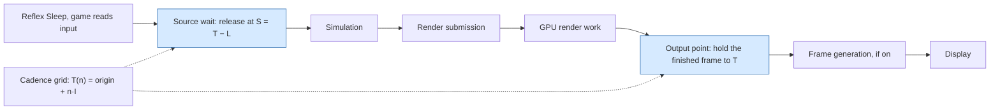

The two highlighted steps are where ReLimiter acts. Where exactly the output point sits depends on the output: a CPU hold at the game's Present marker, a GPU wait on the present queue or a GPU wait in front of the frame-generation input (see [Output Points](#output-points)). The source wait happens either in the game's frame-start marker call or earlier, inside the Reflex Sleep call (see [Where the Source Wait Happens](#where-the-source-wait-happens)).

Three rules hold everywhere:

- **Late frames are never held.** A frame that misses its target passes on at once; the cadence is restarted when it is clearly late.
- **No catch-up burst.** After a late frame the next targets are not squeezed together to make up the time.
- **No mode switching on thresholds.** ReLimiter picks the best output point the game supports and keeps it. Output override forces one; the overload guard only steps aside temporarily.

The pieces that decide the details:

| Piece | Role | Section |
|-------|------|---------|
| Cadence grid | The row of targets `T(n)`, restarted in epochs | [The Cadence Grid](#the-cadence-grid) |
| Lead controller | Learns `L` from measured frames | [Frame Plans and the Lead](#frame-plans-and-the-lead) |
| Source stage | Plans each frame, waits until `S`, releases the game | [Frame Plans and the Lead](#frame-plans-and-the-lead) |
| Pipeline resolver | Chooses the output point and where the source waits | [Output Points](#output-points) |
| Output executors | Hold or pass on each finished frame | [Output Points](#output-points) |
| Protections | GPU wait cap, collision-aware release, overload guard, render handoff limit, Adaptive cap | [Protecting Pacing Under Load](#protecting-pacing-under-load) |

Source: `src/scheduler.cpp` (`OnMarker`, `RunPlanned`), `src/source_stage.h`, `src/cadence_grid.h`, `src/pacing_resolver.h`.

---

## The Cadence Grid

There is one grid per swapchain, owned by the scheduler. Every real frame gets the next grid index `n` and an output target `T(n)`. Every stage takes its target from the grid: the source stage plans from it and the output executors re-resolve `T(n)` from the grid's newest published snapshot, so a restart moves targets of frames that have not been output yet.

The grid is a row of linear segments:

```
T(n) = origin + floor(fraction + (n − base) · I + 0.5)
```

A new segment starts whenever the interval changes or the cadence restarts. The snapshot keeps the newest 8 segments so frames a few plans behind (for example during a frame-generation multiplier ramp) still resolve their target.

### The interval I

`I` is the interval between real frames:

| Contribution | Effect on `I` |
|--------------|---------------|
| FPS cap | `1 / cap`. This is the interval before anything else. |
| Frame generation | Multiplied by the FG divisor (2× FG: `I` is two output intervals, because the cap is the *output* frame rate and the grid paces *real* frames). |
| Adaptive cap | Stretches `I` by 1.0 to 1.6 (see [Adaptive Cap](#adaptive-cap)). Off by default. |
| LFC | While the display gets fewer frames per second than its VRR range, `I` is rounded up so that each displayed frame lasts a whole number of VRR ceiling intervals: a whole multiple of `D` ceiling intervals, `D` the FG divisor. It is judged on the displayed interval `I / D`, so frame generation's real-frame rate below the range does not count. LFC turns on after 10 consecutive frames below the range and off after 10 consecutive frames at or above it. |
| Fixed refresh | On a fixed-refresh display the grid snaps `I` to `k` whole refreshes when it is within 2% of that, and snaps targets to vblank edges. |
| Idle caps | Background FPS, FG-Off Cap and OLED Care run the grid in *idle* mode: lead 0 and no output hold. |

### Epochs

An *epoch* is a stretch of the grid with one phase. A restart starts a new epoch and the new target row begins from a fresh origin. The reasons:

| Reason | What starts it | New origin |
|--------|----------------|------------|
| `Lifecycle` | First plan of a lifecycle: graphics API change, full swapchain teardown, producer change or route change | `T(n) = now + L` |
| `ModeChange` | Timing mode changed between off, VRR, fixed and idle (for example focus lost or regained) | `T(n) = now + L` |
| `PeriodChange` | Cap, VRR ceiling, LFC multiple, raw FG divisor or idle cap changed `I` | Continues from the previous target: `T(n) = T(n−1) + I_new` |
| `SourceLate` | The game reached its source wait later than `S` plus the late tolerance plus its slack | `T(n) = now + L`, released at once |
| `OutputLate` | A frame's output came later than `T(n)` plus the late tolerance | `T(n+1) = o + I`, `o` being that output time |
| `GovernorStep` | On a snapped fixed-refresh grid the Adaptive cap changed its whole-refresh count | Continues from the previous target |

Interval changes that are not one of these (the 50 ms FG divisor ramp, Adaptive cap changes on VRR) are *silent rebases*: the grid continues from `T(n−1) + I_new` and no epoch is counted.

The **Grid epoch** counter in Details counts epochs. An occasional increase is normal.

### Late tolerance and slack

The late tolerance is `tol = max(I / 4, 500 µs)`.

- **Output late.** A finished frame whose output time `o` is later than `T(n) + tol` starts an `OutputLate` epoch. Output evidence that arrives for a frame older than the epoch's base is converted to the equivalent output of the base frame first (`o + (b − n) · I`), so a pipelined game whose next source was already planned does not get a short display interval.
- **Source late.** A source that arrives after `S` is released at once on the same grid when it is within `tol` plus its *slack*. The slack is `L` minus the median measured `X` of the rung (never more than `L`); a source that still makes `T` does not restart the cadence. Later than that, the grid restarts (`SourceLate`).
- **Idle mode** ignores output evidence: its lead is 0 and nothing is held, so late evidence would only stretch the cap.

### No catch-up burst

An output executor holds frame `n` until `max(T(n), o(n−1) + I − slack)` with `slack = tol / 2` and `o(n−1)` the recorded output time of the previous frame (no floor when it is not known). A frame that came out late therefore spaces the next one a full interval after it, minus half a tolerance. Lateness beyond that half tolerance shrinks by half a tolerance per frame instead of pushing the whole cadence later or releasing a burst of short frames.

On the GPU waits the recorded output is the target or the time the frame was decided late, taken on the CPU when the wait is queued. A real frame that reaches the FG input wait after its Signal passes when its GPU work finishes, later than that record, so the floor alone does not see it. DLSS Frame Generation shows a generated frame a fixed time after the previous real frame and the real frame when it is ready, so a real frame's timing error lands mostly on one displayed interval. **FG late-frame spacing** (on by default, developer key `fg_late_spacing`) therefore raises such a frame's record to its GPU readiness when it is read back, resolves the next real frame's floor again just before its Signal, and takes the floor's slack from the displayed interval `T_out = I / D` (`slack = max(T_out / 4, 500 µs) / 2`, `D` the frame's FG divisor). A real frame then enters frame generation no sooner than `I − slack` after the previous one, so each displayed interval is shortened by at most about that slack, as without frame generation. The target only moves later, within the GPU wait horizon; a move beyond `tol` restarts the cadence like any late output. With `fg_late_spacing=false` the next real frame is released on its original target: in CONTROL Resonant at 60 FPS with 2× the displayed frame after a late one then followed the generated frame by 3–5 ms.

A floor move is never made while the game's render thread is still inside the frame's Present when the frame's original target arrives (no PRESENT_END marker of that frame yet). In Streamline's cycle that hold would also hold the render thread, and the next frame would wait behind it: in CONTROL Resonant at 157 FPS with 2×, where the GPU is the limit, the next frame came out late after 42% of such holds against 3% of the others. The worker wakes at the original target to check, releases such a frame there and records that release; at 60 FPS with 2× the render thread had always left by then. Without PRESENT_END markers no move is made.

### Illustration

The chart below uses invented round numbers (`I = 16 ms`, `L = 6 ms`, times in ms on an arbitrary axis) to show the shape of a restart. Frames 1 and 2 are released at `S = T − L`, finish early and wait to their target. The game reaches the marker of frame 3 more than a tolerance and its slack after `S`, so the cadence restarts: the target becomes `now + L`, the frame is released at once and held to the new target. Frame 4 follows one interval later; no frame is shortened to catch up.

```mermaid
gantt
    title Targets and releases, I 16 ms and L 6 ms, illustrative numbers
    dateFormat x
    axisFormat %L
    section Frame 1
    Game work              :a1, 1010, 3ms
    Hold to target         :a2, 1013, 3ms
    Target T1              :milestone, m1, 1016, 0ms
    section Frame 2
    Game work              :b1, 1026, 3ms
    Hold to target         :b2, 1029, 3ms
    Target T2              :milestone, m2, 1032, 0ms
    section Frame 3 late
    Game late for its marker :crit, c0, 1042, 8ms
    Game work              :c1, 1050, 3ms
    Hold to restarted target :c2, 1053, 3ms
    Target T3 after restart :milestone, m3, 1056, 0ms
    section Frame 4
    Game work              :d1, 1066, 3ms
    Hold to target         :d2, 1069, 3ms
    Target T4 is T3 plus I :milestone, m4, 1072, 0ms
```

How the grid plans one frame:

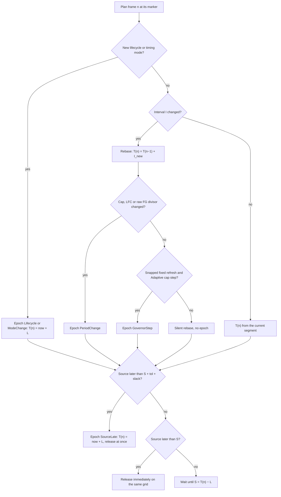

Source: `src/cadence_grid.h`, `src/cadence_grid.cpp` (`PlanNext`, `CadenceGrid_LateToleranceTicks`, `CadenceGrid_ResolveOutputTarget`), `src/pacing_core_types.h` (`PacingEpochReason`), `src/scheduler.cpp` (`VrrCapIntervalUs`, `ApplyLfc`), `src/period_governor.cpp` (`PeriodGovernor_LfcIntervalUs`, `LfcHysteresis`), `src/fg_divisor.cpp` (50 ms ramp), `src/source_stage.cpp` (slack).

---

## Frame Plans and the Lead

### The frame plan

When the game reaches its enforcement marker, the source stage asks the grid for the next index, which gives the frame's target `T`, and computes the source wake time:

```
S = T − L
```

It then publishes a *frame plan* (index, epoch, target, wake time, lead, interval, FG divisor, output point) under the frame's exact key, before it starts waiting. The output executors later look the plan up by that same key and claim it exactly once; a plan that belongs to another output point is never substituted. A source wait is clamped to two grid intervals so a bad target cannot hang the game.

### How the lead is learned

The lead controller keeps one bucket of measured samples per output point and FG divisor. A sample `X` is how long a frame took from its source release `s` to the output point's reference time, without ReLimiter's own holds. What `X` measures depends on the output:

| Output | `X` is measured to | Own holds excluded how |
|--------|--------------------|------------------------|
| `source_only` | PRESENT_START marker arrival `a`: `X = a − s` | Nothing is held |
| `marker_hold`, `native_hold` | PRESENT_START (or the native Present arrival): `X = (a − s)` minus the overlap with the previous frame's CPU hold | The overlap is removed |
| `gpu_queue_wait` | The frame's GPU readiness `r`, floored at the Present call `p`: `max(p, r − c) − s` | `c` is the delay the previous GPU wait carried into this frame through a busy GPU, counted only when that GPU wait actually waited at its gate |
| `fg_input_wait` | The same readiness measure; the render-submission marker (RENDERSUBMIT_START) marks where the frame's GPU work can start. The lead sample is `X − q` | `c` as above. `q` is the time the finished frame waited for the game's render thread to leave the previous frame's Present (SIMULATION_END to the previous PRESENT_END, at most until RENDERSUBMIT_START) |

The lead for the next frame comes from the bucket's samples:

- **Window.** The newest 256 samples. A sample longer than 3 `I` is left out of the lead (it still counts as a missed target).
- **Warm and warming.** With fewer than 32 samples the bucket is *warming* and the lead is a starting estimate: `I / 2` limited to 1–8 ms. After a hold resumes from an overload pause it is the old median plus the allowance until 32 new samples arrive. From 32 samples the bucket is *warm*.
- **Quantile plus allowance.** The warm target is the 99th percentile of the window plus an allowance of 0.5 ms (Smoothing off: 99th percentile, no allowance). About 99 of 100 frames are then finished before their target, and the rest are late and never held. The developer A/B **Lead coverage** (`lead_coverage=95`) uses the 95th percentile instead; the render handoff offset keeps the 95th either way.
- **Slew.** After the first warm lead, the lead moves toward its target by at most `min(100 µs, I / 64)` per planned frame.
- **Budget.** The lead is limited to `[0, 3 I]`. Details marks `, at budget` when the wanted lead was longer, so those frames are likely to miss their targets.
- **Output-specific limits.** On `gpu_queue_wait` the GPU wait cap and the collision-aware release can lower the lead further (see [Protecting Pacing Under Load](#protecting-pacing-under-load)).
- **Other placements.** Present-based pacing uses a fixed 150 µs lead; idle mode and passthrough use 0.

While the overload guard steps a GPU wait aside, its frames are still planned with the GPU wait's lead (at least the warm `source_only` lead), so the release phase does not jump when holds pause or resume.

**Games that wait for the next release.** Some engines finish frame `n`'s Present only after ReLimiter has released frame `n + 1`. ReLimiter's waits for later frames are not that game's time, so the late-output check, the slack evidence and the Adaptive cap's workload judge such a frame without them. The lead keeps the measured `X`, because such a frame cannot be ready before the release it waits for.

**Render threads the GPU holds back.** A GPU-bound game's render thread can sit inside its own window until the GPU nears the end of the previous frame: the driver then receives the frame's first work only in the second half of the window or later, although the GPU did not wait more than 1 ms for the frame and the render thread went straight from the previous frame into this one (or the game has shown that it streams its work: 32 frames with the first work in the first half of the window). That wait belongs to the GPU, not to the frame, yet it lengthens `X`, and a longer lead releases the next frames earlier still, so they are held back too. In Gears of War: E-Day held at 120 FPS with FG 2× and the Adaptive cap, a lead of 42–47 ms started the render thread 17–21 ms before the previous frame's GPU end and every frame was held back; with a lead of 29–35 ms it started 5–11 ms before and none was. So while NVIDIA Reflex reports arrive, a `gpu_queue_wait` or `fg_input_wait` frame's sample waits for its own report. A held-back frame's sample leaves out `W = first work − RENDERSUBMIT_START − F` (`F` from the [render handoff limit](#render-handoff-limit)), less the carried delay `c` already removed. A sample whose report never arrives counts as measured once its frame leaves the controller's window.

### One planned frame

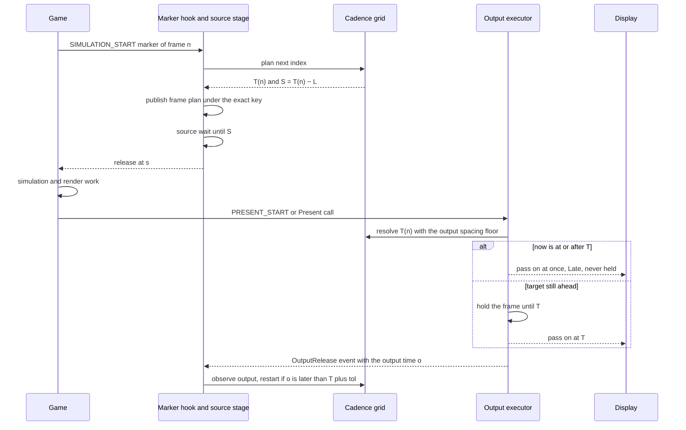

Source: `src/source_stage.h`, `src/source_stage.cpp` (`RunPlannedFrame`, `DrainStageEvents`), `src/frame_plan.h`, `src/lead_controller.h`, `src/lead_controller.cpp` (`NextLeadUs`, `SampleUs`, `QueueUs`, `EmitSample`), `src/pacing_resolver.cpp` (lead parameters), `src/pacing_core_types.h` (`PacingFramePlan`).

---

## Where the Source Wait Happens

The source wait can sit in two places on marker routes (games with NVIDIA Reflex markers or Streamline PCL markers). Present-based pacing, which has no markers, waits at the Present call.

**Marker placement.** The wait runs inside the game's call for the *enforcement marker*, normally SIMULATION_START. The game's thread is blocked in that call until `S`. If a game never sends SIMULATION_START (no admitted one after 200 direct markers while RENDERSUBMIT_START is seen), the enforcement marker falls back to RENDERSUBMIT_START, and returns to SIMULATION_START after 8 consecutive direct SIMULATION_START markers.

**Pre-Sleep placement (the default).** When the game has called the Reflex Sleep within the last second and the enforcement marker is SIMULATION_START, ReLimiter does most of the wait inside the Reflex Sleep call, before the game reads input for the next frame. The marker call then only *trims* what is left, so the game is still released at the exact `S`. The wait aims at the predicted next release minus a *margin*:

```
pre-wait target = T(next) − L − margin
```

where `T(next)` is the previous target plus the shorter of the previous interval and the current cap interval (so raising the cap cannot make the wait end late).

The margin covers what happens between the end of the pre-wait and the moment the frame is ready for its marker wait: the timer's overshoot, the driver's own Sleep when it runs, the game's work up to the marker and the marker hook's processing. That time is measured per frame (the *residual*) and the margin is the 99th percentile of the newest 128 residuals plus 150 µs, at least 150 µs; it is 500 µs until 16 residuals exist. A margin larger than the time left only shortens the pre-wait.

A frame gets no pre-wait when the grid cannot predict its release, when the newest plan is older than 2 intervals, when the wait would be shorter than 200 µs (too close, but the residual is still measured) or longer than 2 intervals, or when a pre-wait for that frame already ran. The marker trim paces such a frame. The margin window starts over whenever the driver's Sleep starts or stops running after the hook, because the residual differs between the two. A frame that its own pre-wait made late is not counted as a missed frame for the Adaptive cap.

### Reflex Sleep bypass

By default ReLimiter's own wait replaces the driver's Sleep. After the pre-wait (or at once, when there is none) the Sleep hook returns without calling the driver; Reflex markers and the game's Reflex mode still reach the driver. The reason is a single pacer: the driver's Sleep otherwise adds a wait of its own after ReLimiter's, and the two would then pace the game independently.

The driver's Sleep still runs when ReLimiter is not pacing the source: with no FPS cap, in Dynamic MFG passthrough, without a presenting swapchain, or with the developer `source_placement=driver` (the Reflex driver limiter then paces the game and ReLimiter plans nothing), or when the developer bypass setting is turned off. NVIDIA Smooth Motion skips the Reflex Sleep entirely.

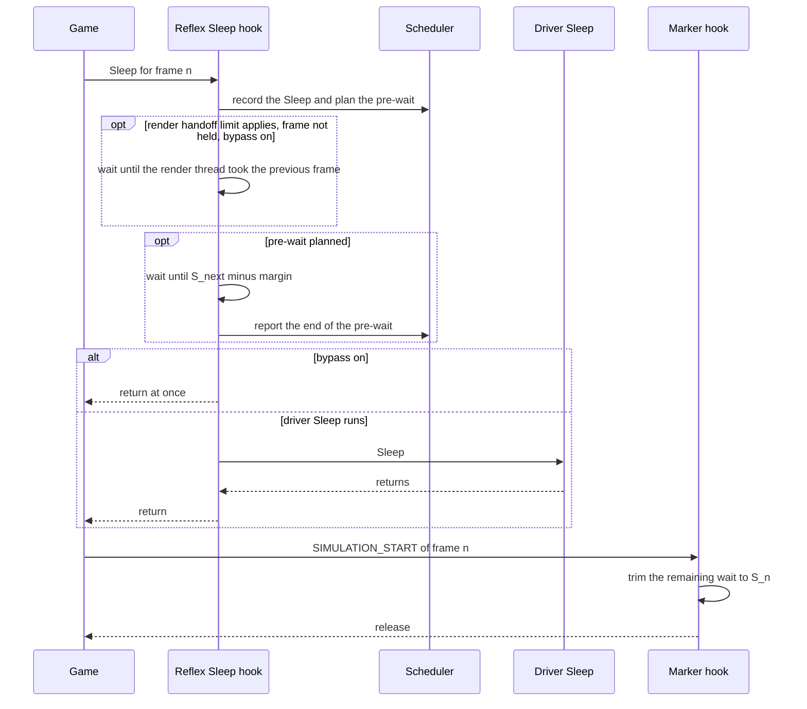

Source: `src/source_placement.h`, `src/source_placement.cpp` (`Decide`), `src/scheduler.cpp` (`Scheduler_PlanReflexSleep`, `PreSleepPredictedIntervalUs`, `DriverSleepRuns`), `src/nvapi_hooks.cpp` (`Hook_Sleep`, enforcement marker fallback), `src/nvapi_hooks.h` (`NvAPI_ShouldBypassSleep`), `src/pacing_resolver.cpp` (`MarkerRoutePlacement`).

---

## Output Points

An *output point* (the *rung* in the code) is where the finished frame is held to its target. ReLimiter has four in normal use and one for developers:

| Output | What it holds | Requirements | Notes |
|--------|---------------|--------------|-------|
| `gpu_queue_wait` | The GPU's present queue waits for `T` before it runs the frame's present work. A worker thread signals the time fence at `T`; the game's threads are not blocked | 64-bit, DX12, native Reflex (NvAPI) markers with the native Present route qualified, the present queue ready, VRR, no frame generation | A target more than `clamp(3 I, 2 ms, 100 ms)` ahead is *undeliverable* and the frame is presented unheld |
| `fg_input_wait` | The GPU waits for `T` in front of each *real* frame's entry to frame generation. One wait per real frame, not per generated frame | 64-bit, DX12, native Reflex (NvAPI) markers, frame generation presenting, the FG input route qualified (an FG input reached an FG-ready queue) | Streamline frame generation of 1 to 3 generated frames per real frame (2× to 4×) |
| `marker_hold` | The CPU holds at the game's PRESENT_START marker until `T` | A marker route (Reflex or Streamline PCL markers) | A hold longer than 1.5 intervals is not performed (undeliverable) |
| `source_only` | Nothing after the source wait. The frame passes at PRESENT_START | None | Used by Present-based pacing, idle caps, passthrough, unqualified FG and the overload pause |
| `native_hold` | The CPU holds at the game's native Present call | Native Reflex (NvAPI) route with native Present attribution qualified | Developer-only. Auto never selects it |

All executors follow the same contract. They claim the frame's plan, resolve `T` from the grid including the output spacing floor, and: if the target has already passed the frame is *late* and passes at once; if the target lies beyond the executor's limit it is *undeliverable* and passes unheld; otherwise it is *held* until `T`. Each executor records the frame's effective output time, which feeds the grid's output-late rule and the spacing floor.

### How Auto resolves the output point

The resolver runs once per marker. It takes the configuration, what the executors have qualified at runtime and the runtime state, and returns the timing mode, source placement, output point and a fallback *reason* naming why the preferred output is not in use. Rules are evaluated in this order:

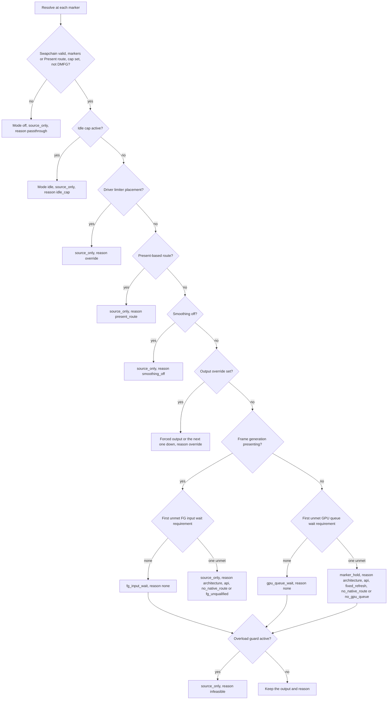

The GPU queue wait requirements are checked in this order, and the first one that fails gives the reason: 64-bit addon (`architecture`), DX12 (`api`), VRR (`fixed_refresh`), native Present route qualified (`no_native_route`), present queue ready (`no_gpu_queue`). They do not mean pacing has failed; the frame is held by `marker_hold` meanwhile.

**Output override** (developer setting) forces one output instead of Auto. If its requirements do not hold, it falls to the next one down: GPU wait and native hold to marker hold, marker hold to source only. An FG input wait without its route falls straight to source only. Override is never changed by the overload guard.

The full reason list is in the Developer Reference ([Fallback Reasons](DEVELOPER_REFERENCE.md#fallback-reasons)).

Source: `src/pacing_resolver.cpp` (`PacingPipeline_Resolve`, `AutoRung`, `OverrideRung`, `GpuQueueBlocker`, `ApplyHoldFeasibility`), `src/presentation_gate.h`, `src/presentation_gate.cpp` (CPU holds), `src/gpu_present_gate.h`, `src/gpu_present_gate_d3d12.cpp` (`Decide`, `Enqueue`, `GpuPresent_Execute`, `GpuPresent_BeginFgInput`), `src/gpu_present_gate.cpp` (`GpuPresent_HorizonTicks`).

---

## Protecting Pacing Under Load

A hold only helps while the game can keep up with its cadence. The mechanisms below keep a held or planned frame from making things worse.

### Late frames are never held

Every executor checks the clock against `T` before it holds anything. A frame that is already late passes on unchanged, the cadence restarts when the lateness exceeds the tolerance, and the output spacing floor keeps the frames after it from being squeezed (see [No catch-up burst](#no-catch-up-burst)). A hold that is implausibly long, or a GPU wait target beyond the horizon, is declined rather than performed.

### GPU wait cap ladder

On `gpu_queue_wait` the lead is limited to the median `X` of the window plus a *cap*, so a typical frame waits on the GPU at most the cap before its target. The cap has four levels, fractions of a 1.5 ms budget: 100%, 5/6, 2/3 and 1/2 (1.5, 1.25, 1.0 and 0.75 ms).

- **Step down** one level when more than 5% of the newest 64 *waited* GPU resumes (frames whose GPU was already waiting at the release) came more than 1 ms after the release, and at least 0.5 s after any level change.
- **Check.** The waited resumes from 2 s to 3 s after a step down are judged. With at least 32 of them and more than 5% still late, the step is undone and no step down is tried for 30 s; with fewer than 32 the step stands.
- **Step up** one level after 30 s in which at most 1% of the waited resumes were late (judged from 20 resumes on).
- **Open top.** With Output override Auto and GPU Wait Probes on, when the next frame's GPU work is seen queueing behind the wait (see below), there is one level above the budget: no cap. Late resumes still bring the cap back.

The late-resume evidence needs GPU Wait Probes (GPU timestamps placed just before and after the wait). Nothing switches the GPU wait off for late resumes.

### Collision-aware release

On `gpu_queue_wait`, a late resume happens when the work after the wait becomes ready while the game's next frame already runs a long command buffer on the same GPU engine: the GPU does not interrupt it, so the resume waits. The release headroom limits the lead so the release does not land in that window:

- **Release headroom `H`.** The lead is at most `I + Q10(D) − H`, where `D` is a frame's time from source release to the start of its heavy GPU work (GPU ready time minus the GPU active render time from its Reflex latency report) and `Q10` is the 10th percentile of the newest 256 values. `H` starts at 1.0 ms and is learned between 0.75 and 3 ms.
- **Release margin `M`.** Without current Reflex GPU active times (none for 64 frames), the same guard uses the time to the next frame's Present call: at most `I + Q10(C) − M`, with `C` the release-to-Present-call time. `M` starts at 2.5 ms and is learned between 1 and 4 ms.
- Either limit applies once 32 samples exist. Both are learned from waited GPU resumes: they widen at once where late resumes collect and narrow one 0.25 ms step after 1,024 resumes in a row with the band below the edge clean or, above the start value, with its late resumes faded (fewer than 4, weighted; the evidence halves about every 23,000 resumes). Without GPU Wait Probes they stay at their start values.
- **Frames that need more lead** reach their gate after the release and are shown when they are ready. Their slack is judged against the lead before the limit, so the Adaptive cap does not count that as a late frame.
- **Standing aside.** Some games run the next frame's GPU work behind the wait (one queue, in order); the wait cannot delay it there. For each waited release whose next frame had begun submitting, the guard compares the next frame's GPU start with the release. It stands aside once at least 32 such pairs exist and none of the newest 64 began more than 100 µs before the release. One pair that did restores the guard at once. The Adaptive cap's hold room stands aside with it. No GPU load, timer or mode switch is involved.

The guard applies with Output override Auto only.

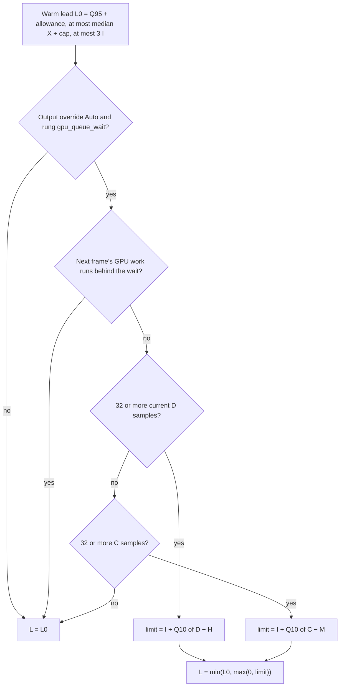

### Overload guard

When the game cannot reach the cap, holding frames costs more than it gains. With Output override Auto, the overload guard watches every planned VRR or fixed-refresh frame whose Auto output is a hold (`marker_hold`, `gpu_queue_wait` or `fg_input_wait`). A *restart* is an `OutputLate` epoch or a `SourceLate` epoch that the pre-Sleep wait itself did not cause.

- **Pause.** More than 10% of the frames in a window of at least 1 s restarted the cadence, and the Adaptive cap cannot lengthen the interval (it is off, or already at +60%). Every Auto hold then resolves to `source_only` with reason `infeasible`.
- **Resume.** The first whole 2 s window without a restart. The paused rung's lead is restarted: until 32 new samples arrive it is the old median plus the allowance (for the GPU waits at least the warm `source_only` lead).
- ReLimiter keeps pacing the source during the pause and the Sleep stays bypassed, so the guard judges the same pacing it resumes into. A paused GPU wait keeps its lead, so the release phase does not jump.
- Lifecycle, cap or FG multiplier changes, route changes and leaving Output override Auto end a pause.

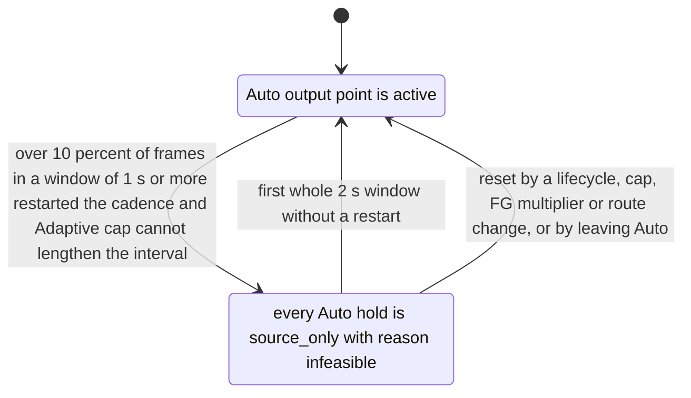

### Render handoff limit

During an overload pause (and anywhere a frame is not held), nothing else stops a game that simulates ahead of its render thread from queueing finished frames when the cap cannot be held. The render handoff limit releases such a frame no earlier than

```
A(n) = max( w(n−1) + d, Ĝ(n−1) − (P/2 + F + σ) )
```

where `w(n−1)` is RENDERSUBMIT_START of the newest released frame, the moment the render thread took it, and `d` is learned from the frames' own timing. `d` comes from samples `h = (b(n−1) − w(n−1)) − (e(n) − s(n))`: how much later frame `n` could have been released and still have ended its simulation (`e`, SIMULATION_END) before the render thread left the previous frame's Present (`b`, PRESENT_END). It is the 5th percentile of the newest 256 samples (`1 − 0.95`) minus the 0.5 ms allowance, never below 0, and 0 until 16 samples exist. A serial engine (render after simulation) gives `h < 0` and `d = 0`, so the limit never binds there.

The second part, the **GPU floor**, covers a render thread that the GPU holds back inside its own window, where `h` cannot see it. Gears of War: E-Day does this at 120 FPS with FG 2× in the overload pause, where it is GPU-bound: when its render thread starts frame `n` more than about 11 ms before the GPU finishes frame `n − 1`, almost nothing of frame `n` often reaches the driver until the GPU nears that end, and the run of held-back frames that follows starts with a stretched GPU frame (a stutter). The driver's Reflex Sleep releases the game at the GPU's own rate (simulation starts 17.12 ms apart, varying by only 0.7 ms, for a GPU frame period of 17.09 ms) and starts the render thread 9.4 ms before the previous GPU end; it never sees the render thread held back. The GPU floor does the same from measurements:

- `Ĝ(n−1)` is when the GPU will finish frame `n − 1`: the later of the newest NVIDIA Reflex report's GPU end (`gpuRenderEndTime`) plus `P` for each frame in between (reports reach ReLimiter about two frames after the GPU end, so this looks about four frames ahead), and the render thread's newest PRESENT_END, seen as it happens, plus the 5th percentile of the reports' PRESENT_END → GPU end gap plus `P` per frame in between. The second sees a frame whose GPU frame stretched two frames before its report does.
- `P` is the GPU's frame period: the median time between the GPU ends of consecutive frames the GPU did not wait for (it started them at most 1 ms after the previous end).
- `F` is the game's own delay from RENDERSUBMIT_START to the frame's first work reaching the driver: the median over frames whose first work came in the first half of the render thread's window.
- `σ` is the time from a release to RENDERSUBMIT_START: the median over frames that are not held.

All are medians of the newest 256 values and apply once 32 exist. The frame's render thread then starts `P/2 + F` before the GPU finishes the previous frame, so its first work reaches the driver half a GPU frame before then: midway between none of the frame queued ahead of the GPU (the GPU would wait) and all of it (a frame ahead). For Gears that is 17.09 / 2 + 0.85 = 9.4 ms, the driver's position. The floor only ever delays a release: a game whose render thread starts later than that against the GPU (CONTROL Resonant 3.9 ms, Deep Rock Galactic: Rogue Core 4.4 ms) is never held by it, and a game whose GPU waits for its frames has no `P` and no floor. Nothing is learned from frames that went wrong: a rule that moved the release later after each held-back frame had to find the edge by hitting it, and each run of held-back frames starts with a stutter. A free-running cadence at `P` would follow GPU changes only through reports two frames old; in a model it fell 2–4 ms further toward the edge after a 0.5 ms GPU change than releases anchored to the newest GPU end.

With an offset from `w(n−1)` alone, Gears in that pause had 80% of frames held back, 36 long displayed frames and 184 jumps above 4 ms per 1,000 and a real-frame PC latency of 46 ms; with the driver's Reflex Sleep none were held back, no displayed frame was long and the latency was 40 ms.

- **Applies to** frames that are not held (`source_only`), in VRR or fixed mode, released at SIMULATION_START by marker or pre-Sleep placement, while the driver's Sleep does not run. Held frames are not limited: on held frames the render-thread part moved CONTROL Resonant's simulation into its render thread's submission. Their lead leaves out the time the GPU held their render thread back instead (see [How the lead is learned](#how-the-lead-is-learned)).
- **Where the wait runs.** With pre-Sleep placement inside the Reflex Sleep hook, before the game reads input; with marker placement in the marker hook. The grid sees `A` as the frame's arrival, so a limit beyond `S` restarts the cadence like any late source, and the overload guard still sees the overload.
- **The stall rule.** A wait ends when the render thread took no frame for 3 of its own frame times (the median of the newest 32 intervals between its handoffs of consecutive frames, without handoffs that came after a stalled wait for them; at least 3 intervals); the frame is then released. Seeing the render thread take a frame before the next frame's release (checked at every frame, limited or not, and by every handoff sample) shows that it does not wait for that release; from then on, within the producer epoch, a stall is a hitch and the limit stays on. Before that, 2 stalled waits in a row turn the limit off: a render thread that waits for the next release stalls every wait. It stays off until the render thread is seen taking a frame before the next release or the next lifecycle, cap, FG multiplier or route change. A handoff older than 1 s counts as no stream and no limit applies.

**The driver's in-Present pacing and the render-thread start hold.** With DLSS Frame Generation and the Reflex Sleep bypassed, the NVIDIA driver still paces the game: it sleeps the thread that calls the game's Present inside `NvAPI_D3D12_SetAsyncFrameMarker` (Streamline's `sl.dlss_g`, through `sl.common`). Which thread that is decides the result. In CONTROL Resonant it is the render thread that starts the next frame, so the sleep is benign and pacing is good. In Gears of War: E-Day it is the engine's RHI submission thread, held about 0.6 ms after the render thread has already started the next frame: that frame's GPU work is submitted late in one burst and the GPU idles (6.3 ms per stalled frame in the trace). Returning to the driver's Sleep fixes Gears and makes CONTROL much worse. ReLimiter only times the marker call (the `async_marker_wait_us` column); it never suppresses, delays or alters it.

The developer A/B **Render-thread start hold** (`render_start_hold`, off by default) puts ReLimiter's own hold where the driver's would belong, in every game: a direct RENDERSUBMIT_START waits until `Ĝ(n−1) − (P/2 + F)`, the GPU floor above without `σ`, when that lies ahead by at most one real frame interval, and then reaches the driver. The render thread then never starts a frame earlier than about half a GPU frame plus the submission delay before the GPU finishes the previous one, so the frame reaches Present no earlier than the driver's point and nothing is left for the driver to hold. The hold is ReLimiter's own wait: it leaves the lead samples and `σ`. It is untested until the A/B has been measured; compare long frames, jitter, GPU idle gaps and PC Latency with Reflex active, one setting per capture.

The developer A/B **Held-frame GPU floor** (`held_gpu_floor`, off by default) extends the GPU floor to frames that are held and removes the driver's measured Present hold from their lead. A held frame released at SIMULATION_START by marker or pre-Sleep placement, while the driver's Sleep does not run, is then released no earlier than `Ĝ(n−1) − (P/2 + F + σ)` as a frame that is not held already is, without the render-thread offset `w + d`, which stays on frames that are not held. In Gears of War: E-Day at 120 FPS with FG 2× and the Sleep bypassed, frames not held (released at the floor) saw the driver's hold inside `NvAPI_D3D12_SetAsyncFrameMarker` at p50 0.01 ms, with each frame's first GPU work reaching the driver 7.1–7.5 ms before the previous GPU end; frames released from the lead (about 39 ms) were held 13.6 ms by the driver and their first work came about 1.2 ms before the GPU end, so the GPU stalled about 3–4 times a second. The hold recorded under async-marker frame `n` delays frame `n + 1`'s first driver submission (correlation with the first-submission delay 0.80–0.82, against 0.48–0.49 for frame `n`, in two captures), so ReLimiter times every call (`Hook_SetAsyncFrameMarker`, pass-through) and leaves the longest hold `H` of frame `n` out of frame `n + 1`'s lead sample on a GPU wait. The sample already leaves out the simulation → render queue `q` and the held-back wait `W` (in CONTROL Resonant the same hold ends before PRESENT_END and is inside `q`; in Gears it comes after PRESENT_END and only `W` sees it), so the exclusion takes `max(q + W, H)` in all and never adds the hold on top of them. It is untested until the A/B has been measured; compare long frames, jitter, GPU idle gaps and PC Latency, one setting per capture, with Reflex active.

With the key on, a held frame keeps the GPU's pace through cadence restarts too. When its floor makes it later than the cadence's release by more than the late tolerance, the restart puts its output target at the floor plus the early side of the lead, `Q_{1−q}(X) − allowance`, instead of a full lead after the floor. A frame released at its floor is ready about that soon, and with the full lead the output hold made a GPU that was already at its limit wait for the difference. In Gears of War: E-Day at 120 FPS with FG 2×, 30 of 33 such restarts stretched their GPU frame, and almost every remaining stutter came on such a restart or within the 8 frames after it. Between restarts these frames reach their output wait after the target, so they are not held and the GPU's pace is the cadence. A frame the GPU finishes before its target is held to the cap as before.

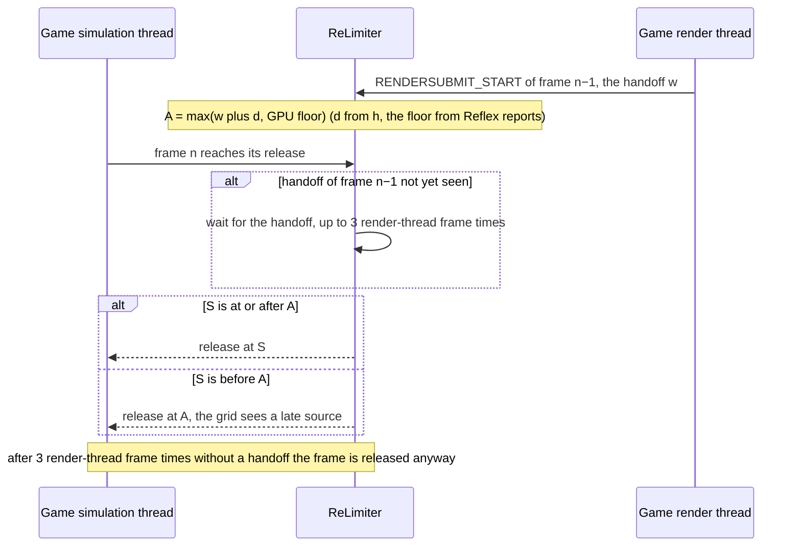

### Adaptive cap

**Adaptive cap** lengthens `I` while frames show it is too short and shortens it again when they do not. It is off by default. The stretch `I / I_0` stays between 1.0 and 1.6 (`I_0` is the cap interval times the FG divisor).

- **Evidence gates every rise.** Two restarts within 0.5 s, or 6 of the newest 24 measured frames ready after their target (the lead expects about 1 in 100), or more than 10% of the frames of a window of at least 1 s restarting the cadence (a window closes after 2 s and restarts after every rise). Reflex workload reports alone never lengthen `I`.
- **Demand sizes a rise.** What recent frames need is the larger of the 90th percentile of the newest 12 Reflex workload reports (at least 4) and the Adaptive cap fit percentile (75, 90 or 99; default 75) of the newest second of reports (at least 16). A report's workload is its longest stage: simulation, render submission or GPU work, where GPU work is the GPU active render time plus, with frame generation, the AI frame time (the generated frames run on the same GPU within the real frame's interval). A rise goes to need plus a margin `m = max(250 µs, 3% of I)`, by at most 8% of `I_0` per 0.25 s. Reports above 1.5 times the median count as hitches and are ignored; reports above 3 `I` are ignored. When more than 10% of a window's frames restarted and demand does not explain it, the rise is 5%.
- **Falls.** After 0.5 s of headroom (the Adaptive cap fit value of the newest second plus two margins fits inside the interval actually paced), `I` falls to need (as defined above, the same as a rise uses) plus one margin, never below `I_0`, so a fall never lands where the next rise would put it back. Without that headroom, after 1 s without evidence it *probes* below the demand: 3% of `I_0`, 1.5 times further for each probe that stayed calm, up to 12%. Evidence after a probe returns it to the level before it and doubles the calm time the next probe needs (1, 2, 4, up to 8 s). A probe waits a calm second after any fall, and none starts while GPU execution time (plus AI frame time) is the largest stage in most reports of the newest second: it does not grow with `I`, so a probe below it can only fail.
- **Failed falls.** A fall to the need that brings evidence back before it has held for a calm second failed: `I` returns to the level before it, and the *demand scale* `k` becomes at least the interval actually paced at the evidence divided by the need that fall used. From then on every need (rises, falls and the headroom test) is `k` times the measured one, so a later fall stops one margin above the interval that failed and still follows the demand when it changes, and no probe runs. `k` is 1 again after a reset. The workload reports can miss part of what a frame needs: in Gears of War: E-Day held with FG 2×, the render thread either kept up or fell a frame behind at the same interval, and only the second showed in its stage times; the cap fell to the GPU work's +10% every 5 to 10 s and climbed back to +28%.
- **Recurring loads.** After a rise `I` does not fall for 1.5 s per overload episode of the last 20 s, up to 8 s.
- **Realized interval.** The interval actually paced follows the target at +3% per frame up and −1% per frame down.
- **Hold room.** With the Auto GPU queue wait, the interval is also kept at least as long as the GPU wait needs: the Adaptive cap fit percentile of the intervals at which recent frames would have reached the wait before their guarded release. It needs no evidence, and it is skipped when it would exceed +60%.
- **Resets.** A cap or FG divisor change, DMFG, OLED Care, regaining focus, a new lifecycle or turning it off return `I` to `I_0`; the next 32 frames are not judged.
- On VRR, interval changes are silent rebases. On a snapped fixed-refresh grid the interval is quantized to whole refreshes and each change of the count is a `GovernorStep` epoch.

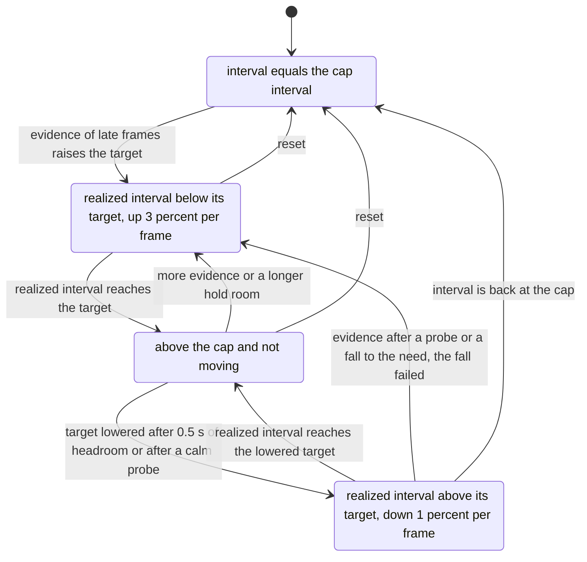

Source: `src/rung_feasibility.h`, `src/rung_feasibility.cpp` (`HoldFeasibility`, `GpuWaitCap`), `src/lead_controller.h`, `src/lead_controller.cpp` (`CollisionGuardedLeadUs`, `HandoffOffsetUs`, `RecordHandoff`), `src/scheduler.cpp` (`HandoffLimitApplies`, `HandoffEarliestRelease`, `RenderHandoffStalled`, `RecordGovernorMiss`), `src/render_handoff.h`, `src/nvapi_hooks.cpp` (`Hook_Sleep`), `src/period_governor.h`, `src/period_governor.cpp` (`Track`), `src/gpu_present_gate.cpp` (`GpuPresent_HorizonTicks`), `src/presentation_gate.cpp` (`PresentGate_Execute`).

---

## Frame Generation and Dynamic MFG

With frame generation (FG) the game renders *real* frames and the driver adds generated frames between them. The FPS cap is the *output* frame rate; the grid paces the real frames:

```
I = (1 / cap) × FG divisor
```

At a 120 FPS cap with 2× FG, real frames are `I = 16.7 ms` apart and the display shows two frames per interval. The Adaptive cap stretch applies to this real-frame interval, so the output frame rate drops by the same proportion.

**The FG divisor.** The divisor is 1 without FG and 2 or more once FG is confirmed active, taken from the sources in this order: NVIDIA Smooth Motion, the driver profile override, the actual multiplier from the FG state, the configured Streamline state, and finally positive Reflex AI frame evidence when Streamline has not reported FG off. The scheduler resolves it once per frame and the OSD and frame splitting read that same value. A change of the raw divisor is a `PeriodChange` epoch and resets the Adaptive cap, the overload guard, the pre-Sleep margin window and the GPU wait cap. The grid interval follows a linear ramp over 50 ms after a toggle; those frames are silent rebases.

**Pacing real frames.** With FG presenting, Auto uses `fg_input_wait` once its route has qualified: the GPU waits in front of each real frame's entry to frame generation, so real frames enter FG on the cadence. Until it qualifies, nothing is held (`source_only`, reason `fg_unqualified`); FG without its route is not held at a marker. Where the FG input wait cannot run (the 32-bit addon, an API other than DX12, or markers from Streamline PCL), the reason names that requirement instead (`architecture`, `api`, `no_native_route`). The lead of `fg_input_wait` leaves out the game's simulation to render queue time `q`, because a pipelined game's finished frame otherwise waits there and the lead would learn that wait as part of its pipeline.

ReLimiter does not time the generated frames: where the driver puts them between two real frames is outside its control.

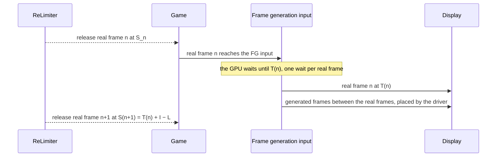

**Dynamic MFG.** With DLSS 4.5 Dynamic Multi Frame Generation the driver changes the multiplier as GPU headroom changes. ReLimiter then uses *passthrough*: timing mode off, no cadence grid, no plan, no source wait and no hold, and the target frame rate is set outside ReLimiter (NVIDIA App, RHI or Profile Inspector). The game's Reflex Sleep reaches the driver as usual, and the OSD and detection keep working. Background FPS and FG-Off Cap, when set, still apply as simple waits between frames without the grid. Passthrough is also used with no FPS cap and with no presenting swapchain.

Source: `src/fg_divisor.h`, `src/fg_divisor.cpp`, `src/scheduler.cpp` (`OnMarker`, `VrrCapIntervalUs`, `RunDmfg`), `src/pacing_resolver.cpp` (`AutoRung`), `src/lead_controller.cpp` (`QueueUs`), `src/gpu_present_gate_d3d12.cpp` (`GpuPresent_BeginFgInput`).

---

## Measurement and feedback

ReLimiter measures its own pacing, and some of the measurements feed back into it.

**Reflex reports.** On NVIDIA Reflex games, ReLimiter reads the driver's latency report for each frame (about 2 to 3 frames after the frame). Its GPU active render time and GPU render start feed the collision-aware release and its queue-order test, and the Reflex workload demand feeds the Adaptive cap. A report's times are on the driver's clock.

**The clock map.** To compare driver times with its own QPC times, ReLimiter pairs each report with the QPC time its PRESENT_START hook recorded for the same frame, and keeps the offset between the two clocks over the newest 128 matched frames. The map is *stable* once 32 frames exist and the trimmed spread (about the 3rd to 97th percentile) is under 100 µs. The driver's GPU render start, which the queue-order test of the collision-aware release uses, is mapped to QPC only while the map is stable.

**Joined telemetry.** Producers on the scheduler (source release), the Present threads, the GPU gate, the readiness probes, the Reflex reports and the display source push small records without locks or allocation. A telemetry worker joins them by exact frame key, never by arrival order: an ambiguous or missing join leaves its fields empty and is counted. From the joined records it computes the runtime metrics. This path observes pacing; it does not feed back into it.

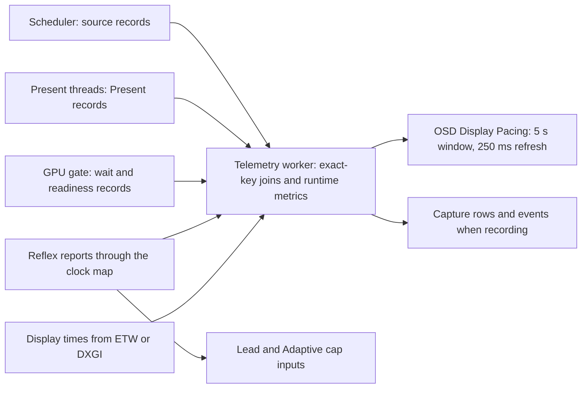

**What you see.** The OSD's **Display Pacing** shows, over the last 5 seconds, refreshed four times per second: the display interval, jitter (the change from one display interval to the next), long and short frame counts, animation error (the difference between how far apart ReLimiter released two rendered frames and how far apart they were displayed), release to display, GPU residence and CPU hold. Display times come from PC latency collection (ETW) when it is collecting, otherwise from DXGI frame statistics. A capture (Telemetry Logging) records one joined row per displayed frame plus an events file with pipeline changes, cadence restarts and controller transitions; see [Capture Files](DEVELOPER_REFERENCE.md#capture-files).

**Analysis.** A capture's rows hold each frame's plan, release, output and display times, so pacing can be compared offline; the [Developer Reference](DEVELOPER_REFERENCE.md#capture-files) lists the columns and events.

Source: `src/feedback.cpp`, `src/feedback.h`, `src/reflex_clock_map.h`, `src/pacing_telemetry.h`, `src/pacing_telemetry.cpp`, `src/pacing_join.h`.

---

## Glossary

| Term | Meaning |
|------|---------|
| `n` | Grid index of a real frame within a lifecycle. |
| `I` | The grid interval between real frames: the cap interval times the FG divisor, stretched by the Adaptive cap and rounded by LFC or the fixed refresh. `I_0` is the interval before the Adaptive cap and LFC. |
| `T` | A frame's output target `T(n)`, from the grid. |
| `S` | The source wake time `S = T − L`: when the game is released. |
| `s` | The time the game was actually released (after the wait). |
| `L` | The lead: how long before `T` the game is released. |
| `X` | A measured sample: time from source release `s` to the output point's reference time, without ReLimiter's own holds. The lead is learned from `X`. |
| `o` | A frame's effective output time: when the hold ended, or when it was passed on or declined. |
| `p`, `r` | Present call time and GPU ready time of a frame, used by the GPU waits. |
| `a` | PRESENT_START marker arrival. |
| epoch | A stretch of the grid with one phase. A restart starts a new epoch (see [Epochs](#epochs)). |
| rung | The code's name for an output point. |
| lead | See `L`. *Warming* below 32 samples, *warm* from 32. |
| allowance | Extra time added to the lead's quantile: 0.5 ms with Smoothing on. |
| `tol` | Late tolerance: `max(I / 4, 500 µs)`. |
| slack | `L` minus the median `X` of the rung; how much later than `S` a source can arrive and still make `T`. |
| `C`, `D` | Release-to-Present-call time and release-to-heavy-GPU-work time of a GPU wait frame. |
| `H` | Release headroom: how long before the next frame's heavy GPU work the GPU wait is released (learned, start 1.0 ms). |
| `M` | Release margin: the same distance to the next Present call (learned, start 2.5 ms). Used without Reflex GPU times. |
| `w` | RENDERSUBMIT_START: the moment the game's render thread takes a frame. |
| `e`, `b` | SIMULATION_END and PRESENT_END markers of a frame. |
| `q` | The time a finished frame waited for the render thread to leave the previous Present; left out of the `fg_input_wait` lead. |
| `h` | One render handoff sample: `(b(n−1) − w(n−1)) − (e(n) − s(n))`. |
| `d` | The render handoff offset: the 5th percentile of `h` minus the allowance, at least 0. |
| `P`, `F`, `σ` | The render handoff GPU floor's measurements: the GPU frame period of consecutive frames the GPU did not wait for, the delay from RENDERSUBMIT_START to the frame's first work reaching the driver when the work streams, and the time from a release to RENDERSUBMIT_START of frames not held; medians of the newest 256, used from 32. |
| `Ĝ` | The predicted GPU end of the newest released frame: the later of the newest Reflex report's GPU end and the render thread's newest PRESENT_END plus the low end of its gap to the GPU end, each plus `P` per frame in between. |
| `A` | The earliest release of the render handoff limit: `A(n) = max(w(n−1) + d, Ĝ(n−1) − (P/2 + F + σ))`. |
| `k` | The Adaptive cap's demand scale: 1, or after a failed fall the paced interval at the evidence over the need that fall used. |
| Adaptive cap stretch | `I / I_0`, between 1.0 and 1.6. |
